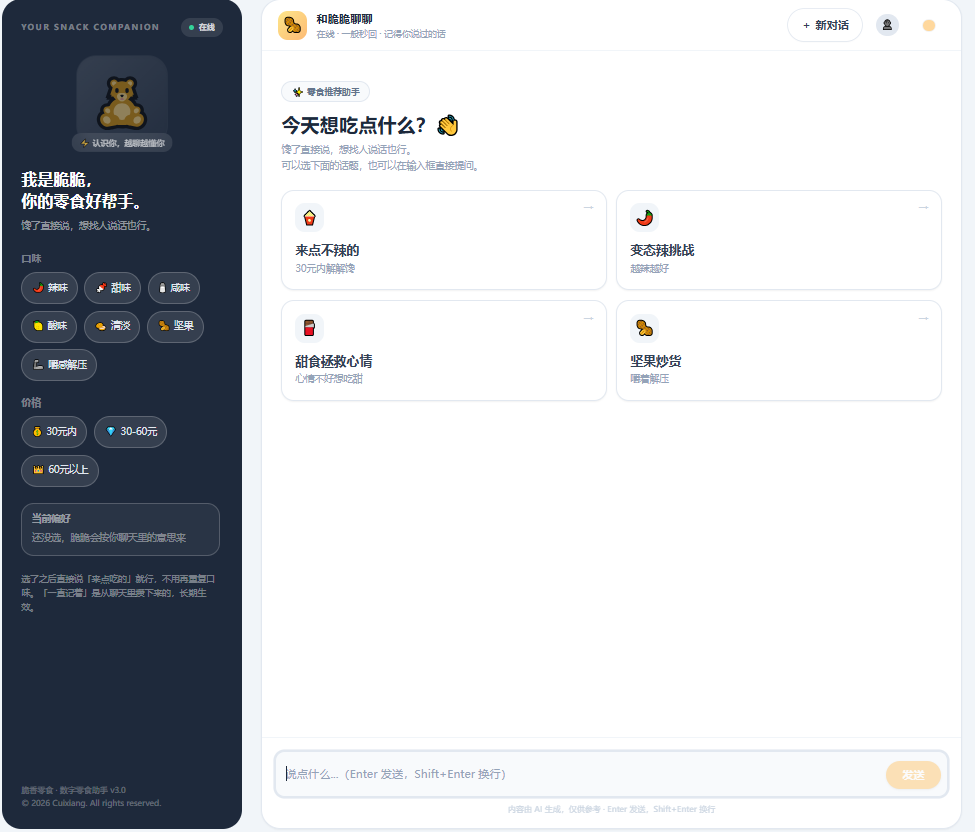
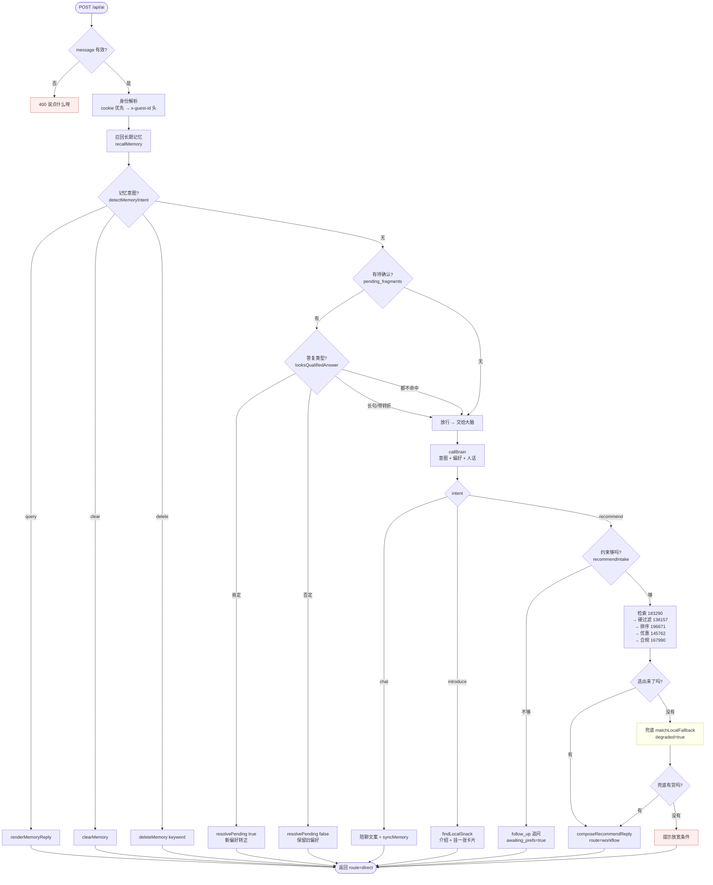

# 脆香 · 零食推荐助手

一个带**长期记忆**的零食推荐助手。不是客服机器人，是那种会记得你"不吃辣"、
会在你吐槽加班时先陪你两句再顺手推零食的搭子。

- 外壳：Next.js 15（App Router）
- 内核：确定性选品链路（需求抽取 → 检索 → 硬过滤 → 排序 → 优惠 → 合规），**不靠模型选品**
- 大脑：DeepSeek（主）/ 智谱 GLM（备），只负责"判断意图 + 抽偏好 + 说人话"
- 编排：默认本地工作流，Coze / Dify 只是可选外挂


---

## 快速开始

```bash
npm install
cp .env.example .env.local   # 然后填 Key
npm run dev                  # http://localhost:3000
```

浏览器打开 <http://localhost:3000>。

**后台**：<http://localhost:3000/admin>

```bash
npm run gen-password -- 你想用的口令 --write   # 生成口令哈希并写进 .env.local
```

不配 `ADMIN_PASSWORD_HASH` 时后台是**禁用**的（fail-closed，不会因为漏配而门户大开）。

**回归测试**（需 dev server 已启动）：

```bash
npm run smoke              # 跑全部用例
npm run smoke -- --only-prune   # 只清理历史残留的测试用户
```

**不需要起服务的快速检查**（秒级，改完先跑这个）：

```bash
npm run verify   # tsc --noEmit + vitest（69 条：admin 票据 / profile-guard / reco-guard）
npm run lint     # ESLint 9 flat config，0 error 0 warning 才收工
npm run format   # Prettier 统一代码风格；npm run format:check 只检查不改
npm run guard    # 守卫脚本 CLI 版（profile-guard + reco-guard），和 vitest 同一批断言
```

> `verify` / `lint` / `format:check` 全绿才值得去跑 smoke——smoke 一轮要好几分钟。

**长期记忆清理**（V2.0 之后存在 SQLite 里，脚本走 Prisma）：

```bash
npm run prune-memory                          # 默认试运行：列出 7 天未活跃的游客
npm run prune-memory -- --apply               # 真的清（先归档到 data/memory-archive-<日期>.json）
npm run prune-memory -- --days=30 --apply     # 改成 30 天
npm run prune-memory -- --include-accounts    # 连正式账号的记忆一起清（账号本身保留）
npm run prune-memory -- --smoke-only          # 只清 smoke_ 前缀的测试用户
```

**数据库备份**（`VACUUM INTO` 在线备份，不用停服务）：

```bash
npm run db:backup                 # → data/backups/cuixiang-<时间戳>.db
npm run db:backup -- --keep=30    # 只留最近 30 份自动备份
npm run db:backup -- --out=d:/tmp/cx.db   # 指定目标文件（不会被 --keep 清理）
```

---

## 环境变量

见 `.env.example`（不含任何真实密钥）。主要是 `LLM_PROVIDER` / `DEEPSEEK_API_KEY` /
`GLM_API_KEY` / `ORCHESTRATOR` / `ADMIN_PASSWORD_HASH`。

`LLM_PROVIDER` 决定主大脑，另一个有 Key 的会自动兜底切换。

V2.0 起还有两个**必须配**的：

| 变量 | 用途 | 缺了会怎样 |
|---|---|---|
| `DATABASE_URL` | 长期记忆落 SQLite（`file:../data/cuixiang.db`）。必须写在 `.env`，Prisma CLI 不读 `.env.local` | 直接起不来 |
| `AUTH_SECRET` | 签 `cx_token` / `cx_guest` 的密钥，≥16 字符（建议 32 位以上随机串） | **签发抛错、校验一律当未登录**：注册/登录全坏，所有人都退回游客态。上云必须配在平台环境变量里 |

---

## 一次请求是怎么走的



### 四条分支

| 分支 | 什么时候走 | 干什么 |
|---|---|---|
| `chat` | 陪聊 / 模型误判成推荐的降级 | 回一句人话，**本轮不出卡片**；带 `lead_in` 说明在铺垫 |
| `recommend` | 用户明确要货、或在推荐上下文里改条件 | 走完整选品链路，出 3 张卡片 |
| `introduce` | 在打听具体某一款 | 介绍文案 + 能配上就挂一张卡片 |
| `pending` | 上轮抛过「你之前说过 X，现在改口了？」 | 本地直接办结，**不调模型**；说了别的就放行 |

### 兜底与降级

- **大脑挂了（Key 欠费 / 两个 provider 都超时）→ `runLocalBrain`**：意图、选品、硬过滤、话术合成转本地链路，响应标 `degraded`，不再是 500。忌口硬约束一条不松，详见 `系统prompt汇总.md` 第 15 节
- 编排挂了 → `matchLocalFallback` 兜内置库，置 `degraded`
- 一件都没选出来 → 再兜一次；实在没有才走追问
- **约束不足的追问不兜底**——追问就是本轮产出，兜底会用卡片把问题盖掉

兜底与主链路共用同一份硬约束判定（`violateHardConstraint`），不另写一份更松的。

---

## 流式输出（SSE）

前端调 `POST /api/ai/stream`，事件序列：

```text
event: stage   {"stage":"memory"|"thinking"|"finalizing"}
event: delta   {"text":"行，"}
event: cards   {"recommendations":[...]}
event: final   {完整响应体，结构同 /api/ai}
event: error   {"message":"..."}
```

**流式只负责抢先显示，最终内容一律以 `final` 为准。**
最终文案可能被本地防呆改写（模型前面说得好好的，最后突然蹦一句"清单如下"，
就整句兜掉换成人话），所以 `final` 到达时会整体替换气泡——用户可能看到文字闪一下。

流式链路不通（代理缓冲 / 超时 / 断网）会自动退回 `/api/ai`，
用户最多是"没看到打字效果"，而不是"发不出去"。

### 正则防呆怎么分块

| 类别 | 什么时候跑 | 例子 |
|---|---|---|
| 输入侧（判用户说了什么） | 流开始前，同步跑完 | `detectMemoryIntent` / `allowRecommend` |
| 输出侧（判模型吐了什么） | 流结束后，整句跑 | 敬语 / 内部信息 / 脏话 / 空头许诺 |
| 字符级（零宽字符） | 流进行中，逐块跑 | `ZERO_WIDTH_PATTERN` |

输出侧不能分块的原因：pattern 会跨 chunk。"我给你挑了三样"会被切成
"我给你挑" + "了三样"，分块跑必然漏判。

---

## 目录结构

```text
app/
  page.tsx              聊天界面主壳（状态 + 发送链路，流式优先，失败自动退回一次性）
  _components/          界面零件（气泡 / 卡片 / 筛选栏 / 皮肤 / 防抖写盘 / 常量类型）
  admin/page.tsx        后台（口令登录）
  api/ai/route.ts       普通入口：解析 → 大脑 → 分流 → 返回
  api/ai/stream/route.ts 流式入口（SSE）：同一套判断，边收边吐
lib/
  chat/handlers.ts      两条入口共用：记忆意图 / 待确认 / 推荐逻辑
  rules/patterns.ts     ★ 全部意图 / 偏好 / 规则表达式
  prompts/
    system-prompt.ts    ★ 人设唯一真源（正文 + 目录 + 约束描述）
    catalog.ts          商品清单（由 snacks.ts 动态生成）
  llm/
    index.ts            大脑调用 + 意图防呆 + 偏好兜底抽取
    brain-stream.ts     流式大脑通道 + 增量 JSON 解析（SSE 用）
    local-workflow.ts   本地选品链路（对应 Coze 工作流节点）
    orchestrator.ts     编排切换 + 内置库兜底
    reply-composer.ts   推荐话术合成
    category-words.ts   品类 / 场景 / 情绪词表
    time-context.ts     时段上下文
  memory/store.ts       长期记忆（分层 / 状态 / 决策 / 串行锁）
  data/snacks.ts        商品数据 + 每日推荐理由
scripts/
  smoke.mjs             回归测试（端到端，要 dev server）
  profile-guard.ts      偏好抽取 / 记忆删除关键词守卫（纯函数）
  reco-guard.ts         检索强约束 / 诚实理由 / 气泡文案守卫（纯函数）
  fallback-guard.ts     兜底链路的忌口守卫
  guard-types.ts        守卫结果的统一形状（CLI 与 vitest 共用）
  gen-password.mjs      生成后台口令哈希
  prune-memory.ts       长期记忆清理（Prisma，先归档再删）
  backup-db.ts          SQLite 在线备份（VACUUM INTO）
tests/
  *.test.ts             vitest：把上面三份守卫的断言变成正式用例
```

---

## 提示词与规则在哪

| 改什么 | 去哪改 |
|---|---|
| 人设、语气、输出规范 | `lib/prompts/system-prompt.ts` |
| "什么样算开口要"、忌口说法 | `lib/rules/patterns.ts` |
| 商品、价格、库存、推荐理由 | `lib/data/snacks.ts` |
| 选品 / 排序 / 优惠 / 合规 | `lib/llm/local-workflow.ts` |
| 记忆分层与冲突决策 | `lib/memory/store.ts` |
| 前端文案（开场白、引导、报错） | `app/page.tsx` |

> ⚠️ 改完跑 `npm run smoke`。改人设或规则的正本，还要同步 `系统prompt汇总.md`。

---

## 文档索引

| 文档 | 干什么 |
|---|---|
| [`系统prompt汇总.md`](./系统prompt汇总.md) | **全链路提示词与话术规则总索引**，改人设前先读它 |
| [`docs/脆香零食-完整项目文档.md`](./docs/脆香零食-完整项目文档.md) | 设计留档（含早期版本人设，**改它对线上行为无效**） |
| [`workflow.txt`](./workflow.txt) | 最初的 Coze 工作流导出，节点编号在代码注释里仍被引用 |
